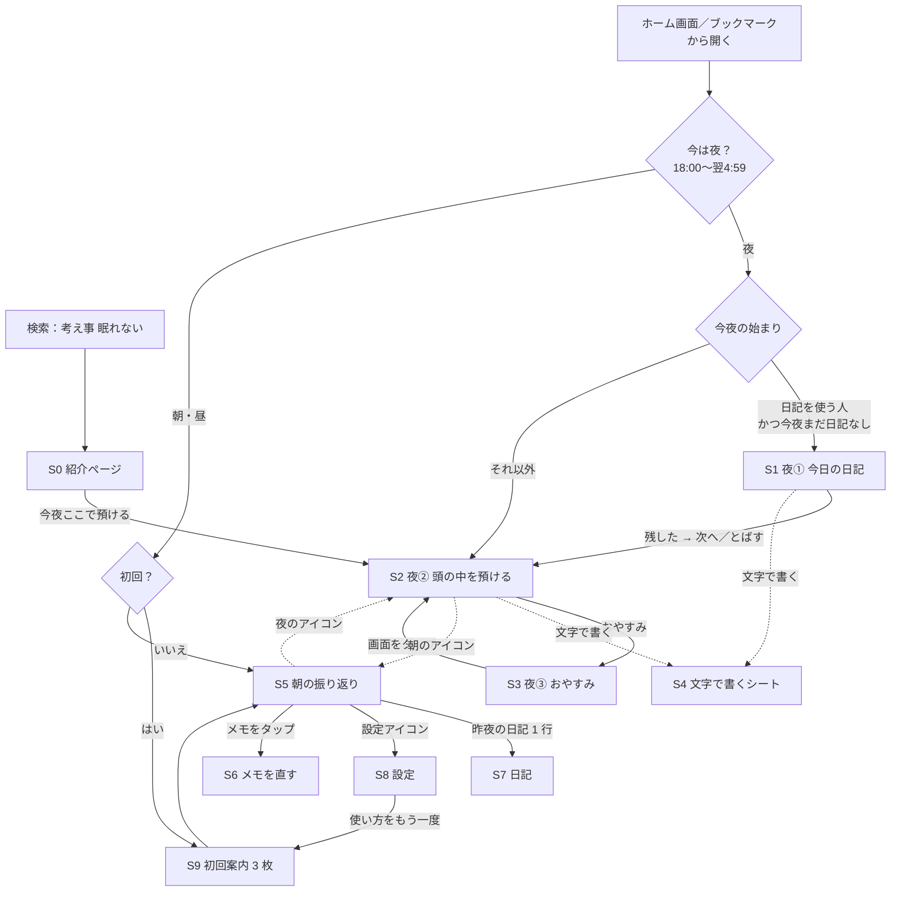

# 画面の流れ（MVP 初版）

- 作成：2026-10-25／UX/UI デザイナー役
- 状態：**案**（backlog.md の「確認 1」〜「確認 3」がまだオーナー確認待ちのため、その答えで変わりうる）
- 前提：backlog.md §5 の **案A「今日は残す、明日は手放す」**。夜は「①日記（とばせる）→ ②預ける → ③おやすみ」、初めての人の最初の夜は「②預ける」から
- 音声の方式（方式W：Web Speech API／方式K：キーボードの音声入力）は未決。この流れはどちらでも同じ。違いは画面の中のふるまいだけ（`screens.md`）

---

## 1. 画面の一覧

| ID | 画面 | 配色 | 検索に出すか | 主なストーリー |
|---|---|---|---|---|
| S0 | 紹介ページ | 夜（紹介） | **出す**（ここだけ） | US-50〜52 |
| S1 | 夜①：今日の日記 | 夜 | 出さない（noindex） | US-10・11・13 |
| S2 | 夜②：頭の中を預ける | 夜 | 出さない | US-01〜06 |
| S3 | 夜③：おやすみ（真っ黒） | 夜（黒） | 出さない | US-07・13 |
| S4 | 文字で書くシート（S1・S2 の上に重なる） | 夜 | – | US-02・11、方式K |
| S5 | 朝：昨夜の振り返り | 朝 | 出さない | US-20〜24・14 |
| S6 | 朝：メモを直す（S5 の上に重なる） | 朝 | – | US-22・23 |
| S7 | 日記の一覧／日記を読む | 朝 | 出さない | US-12 |
| S8 | 設定 | 朝 | 出さない | US-30〜33・52 |
| S9 | 初回案内（3 枚） | 朝 | 出さない | US-43 |

- URL の案：紹介ページは `/`、アプリは `/app/` 以下（夜・朝・設定はアプリ内の切り替え）。一体型にするか（§13 案F）は backlog の「確認 2」で決まる
- 夜の画面にはナビゲーションを出さない（§5-1）。夜から行けるのは「朝の画面へ」の小さなアイコンだけ。設定は朝の画面から入る

## 2. 全体の流れ



### 「今夜の始まり」の決め方（案A を夜の画面の単純さと両立させるための規則）
1. **直近の夜に日記を残した人**で、**今夜まだ日記がない** → S1（日記）から始める
2. それ以外（初めての人、日記を使っていない人、今夜はもう日記を残した人、「おやすみ」のあと目が覚めて開き直した人）→ S2（預ける）から始める
3. S2 には、いつでも S1 へ行ける小さな入り口「今日の日記」を置く（MVP の最小形。US-13 の前でも日記は使える）

- 毎晩かならず日記から始めると、「考えごとで眠れない、早く預けたい」夜に 1 手間増える。日記を使う人にだけ①を出すことで、案A の流れと「1 タップで話し始められる」（US-01）を両立させる
- この規則でよいかは §6「オーナーに決めてほしいこと 1」

## 3. 人ごとの道筋

### 3-1. 初めて使う人（検索から、夜、布団の中）
```
検索「考え事 眠れない」
 → S0 紹介ページ（暗い配色）。最初の画面に「今夜ここで預ける」
 → S2 夜②（初めての夜だけ、ボタンの下に使い方を 1 文）
 → 話すボタンをタップ
     方式W：暗いシート「最初の 1 回だけ、マイクの使用を確認する画面が出ます（少し明るい画面です）」→［続ける］→ iPhone の許可ダイアログ → 録音
     方式K：S4 が開き、キーボードが出る。「キーボードのマイクで話せます」
 → 話す → 停止（タップ、または無音 10 秒）→「預かりました」
 → ［おやすみ］→ S3 真っ黒
```
- 初回案内（S9）は**夜には出さない**。夜中に 3 枚の案内を読ませると目が冴えるため（US-43「夜ではなく初回案内か朝モードで」）。最初の朝に開いたとき S9 を出す
- 夜にどうしても避けられないのは方式W のマイク許可ダイアログ（白い）だけ。その前に暗いシートで予告して、驚かせない
- 日記は最初の夜には目立たせない（S2 の小さな入り口だけ）。S9 の 3 枚目で「今日の日記も残せます」と知らせる

### 3-2. 2 回目以降の人（ホーム画面から、夜）
```
ホーム画面のアイコン → 夜の時刻なので夜の画面
 ├ 日記を使っている人：S1 今日の日記 →（話す／とばす）→ S2 → おやすみ → S3
 └ それ以外の人　　　：S2 → おやすみ → S3
夜中に目が覚めて開き直した：S2 から（日記はもう聞かない）
```
- S1 の「とばす」は S2 の「おやすみ」と同じ位置（右下）に置き、親指 1 回で進める
- S3 で画面をタップすると S2 に戻る（「また思い出したら、タップで戻れます」）
- 注意：Safari のタブで使っていた人がホーム画面に追加すると、データは引き継がれず「初めての人」として扱われる（§13 案F の注意）。引き継ぎは backlog の「確認 2」次第

### 3-3. 朝に開いた人（通勤中、片手）
```
アイコン → 朝の時刻なので朝の画面
 ├ 最初の朝：S9 初回案内（3 枚・とばせる）→ S5
 └ 2 回目以降：S5
S5：日付「10月24日の夜」→（昨夜の日記があれば 1 行）→ やること／気になること／アイデア／その他 →［全部見た］
 → 「全部見ました。今夜もここで待っています」
```
- 30 秒で見終わる想定（§13 案I）。主な操作（完了のチェック・全部見た）は画面の下半分に置く
- 日記の本文は S5 の一覧に混ぜない。1 行の知らせからタップで S7 に開く（US-14）
- 前夜のメモがない朝は「昨夜は何も預かっていません」と一言だけ（US-20）

### 3-4. 設定（S8）
- 入り口は S5 右上の設定アイコンだけ。夜の画面からは入れない
- 中身：夜／朝の切り替え（自動・いつも夜・いつも朝）、データの扱い（§12 の文言）、書き出す、全部消す、使い方をもう一度見る（S9）、眠れない日が続くとき（US-52）

## 4. 案A と案B の比較（短く）

| | 案A：夜の流れに日記を入れる（①日記 → ②預ける → ③おやすみ） | 案B：日記は別の入り口 |
|---|---|---|
| 夜の画面 | 日記を使う人だけ①が出る。使わない人は今と同じ 1 画面 | いつも 1 画面（預ける）。日記は小さな入り口から |
| よい点 | 「今日を閉じる → 明日を手放す → 眠る」が 1 本の流れになり、オーナーの意図を生かせる。日記に気づかれやすい | 一番単純。紹介ページの約束（考え事を預ける）とぶれない |
| 気になる点 | 規則（§2）が 1 つ増える。①で長く話すと寝る時間が遅れる | 日記に気づかれにくく、使われないおそれ |
| 作る手間 | S1 と「今夜の始まり」の判定が増える | S1 は同じ部品で作れる。判定は不要 |

**おすすめ：案A（ただし §2 の規則つき）。** MVP では S2 に日記の入り口を置くだけ（＝案B の形）で一周させ、US-13 で §2 の規則を足すと、作り直しなしで案A に進める。どちらに決まっても S1・S2・S4 の部品は同じ。

## 5. 画面の遷移で守ること
- 夜の画面どうしの切り替えは、アニメーションなしで差し替える（動きを使わない）
- 夜から朝の画面に切り替えたとき、いきなり明るくしない。夜の時間帯に S5 を開いたときは「明るい画面に切り替えます」の確認を 1 回はさむ（夜の時間帯の朝画面を暗いまま出すかは、実装時にエンジニアと相談）
- アプリの更新で、夜の画面に突然の再読み込みや白い画面を起こさない（US-44）。更新は次に朝の画面を開いたときに当てる

## 6. オーナーに決めてほしいこと

設計（flow.md・screens.md・tokens.md・mock/night.html）を通しての確認です。backlog.md の「確認 1〜3」とは別に、画面設計として決めたいものだけ挙げます。

1. **夜の始まりの画面（§2 の規則）。** 「直近の夜に日記を残した人だけ、①今日の日記から始める。それ以外は②預けるから」でよいですか。毎晩かならず①から始める形（案A そのまま）にすると、日記を使わない人にも毎晩「とばす」の 1 手間がかかります。おすすめは規則つきの形です。
2. **夜の文字の明るさ。** 試作の文字色 `#7a6a58` は背景に対して 3.77:1 で、読む文字の基準（4.5:1）に届きません。読む文字だけ `#917e68`（5.04:1）に少し上げ、`#7a6a58` に近い暗さは大きい文字とアイコンに回す案です（`tokens.md` §1）。iPhone の明るさを一番下げた状態で `mock/night.html` を見て、「まぶしくない」と感じるか確かめてください。
3. **「おやすみ」画面（S3・真っ黒）を MVP に入れるか。** backlog では Could（US-07）ですが、案A の流れの終わり（③）にあたり、作る手間も小さい見込みです。入れない場合、S2 の右下は「おやすみ」の代わりに何も置かない形になります。おすすめは MVP に入れることです。
